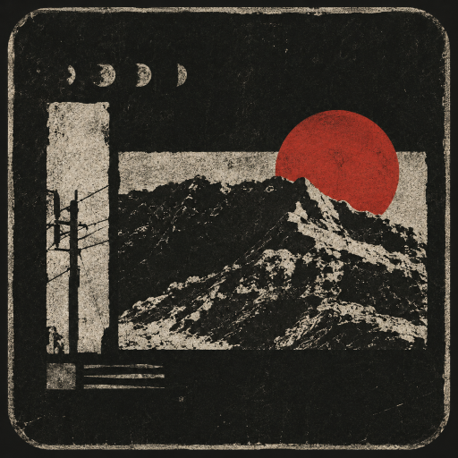

<p align="center">
  
</p>

# Omnipotent Youth Society Design

万能青年旅店视觉设计研究与 Agent Skill（美学偏向于第二张录音室专辑 **《冀西南林路行》 / Inside the Cable Temple**）。

An independent visual design study and reusable agent skill inspired by **Omnipotent Youth Society**, with a focus on *Inside the Cable Temple*.

这是一份独立整理的设计参考，包含可复用技能、设计规范、带来源的图像档案和可离线运行的 HTML 样本；不是乐队或原设计师发布的官方规范。

**[在线预览：林路图志](https://shangxin.me/omnipotent-youth-society-design/)**

## 内容结构

- [skill/SKILL.md](skill/SKILL.md)：符合 WorkBuddy 开放平台与 Agent Skill 规范的技能主文件（展示名：**万能青年旅店视觉设计**，标识：`omnipotent-youth-society-design`，包含 `icon` 元数据）。
- [skill/assets/icon.png](skill/assets/icon.png) / [assets/icon.png](assets/icon.png)：512×512 矿物墨色项目与技能 Icon。
- [skill/references/](skill/references/)：补充规范与信源考据（含 [DESIGN.md](skill/references/DESIGN.md) 与 [SOURCES.md](skill/references/SOURCES.md)），在 SKILL.md 中通过 `@references/` 注入。
- [skill/templates/](skill/templates/)：跨媒介设计模板（含 `web-rubbing-view.html` 拓片视口、`poster-template.svg` 金石矢量海报与 `workflow.sh` 流水线脚本）。
- [DESIGN.md](DESIGN.md)：构图、色彩、字体、材料、交互与验收规则。
- [检索记录](research/SOURCES.md)：原始出处、证据层级与未确认事项。
- [素材索引](research/asset-manifest.json)：逐项来源、尺寸、文件名和下载状态。
- `page.template.html`：HTML / CSS / JavaScript 源模板，包含漫游、图录和规约三个视图。

## 技能与开放平台规范

本技能对齐 [WorkBuddy 开放平台技能市场规范](https://open.workbuddy.cn/docs/skill#技能市场) 及通用 Agent Skill 标准：
- **Frontmatter 元数据**：完整定义 `name`、`display_name`（万能青年旅店视觉设计）、`icon`（`assets/icon.png`）、`description`、`description_zh`、`description_en`、`category`、`version`、`author` 等标准字段，符合技能市场发布规范。
- **自包含资源架构**：技能包（`skill/`）自包含 `assets/icon.png` 图标资产，脱离主仓库独立分发至 Agent 宿主环境（如 Codex / WorkBuddy 平台）时头像不丢失。
- **子资源调用**：规范使用 `@references/` 与 `@templates/` 语法，确保 Agent 与平台能自动挂载上下文。
- **合规静态检查**：可一键校验技能元数据、目录结构与引用有效性：

```sh
python scripts/validate_skill.py
```

## 使用技能

将整个 [`skill/`](skill/) 目录复制到你的 Agent 技能目录，并命名为 `omnipotent-youth-society-design`。保留 `references/`、`templates/` 和 `assets/`，不要只复制入口文件。

使用 Codex 时，可放在 `~/.codex/skills/omnipotent-youth-society-design/`，然后通过 `$omnipotent-youth-society-design` 调用。技能文档本身不依赖 Python 或浏览器运行环境。

## 构建离线页面与技能发布包

需要 Python 3.11 或更新版本。在仓库根目录运行：

```sh
python -m pip install -r requirements.txt
python build.py
```

直接用浏览器打开生成的 `index.html`。图片和展示字体均已嵌入，浏览页面不需要联网；访问出处链接需要联网。

构建同时生成可直接上传或分发的 ZIP 包：

```text
dist/
  omnipotent-youth-society-design.zip       # 完整技能包（含 SKILL.md, references/, templates/, assets/）
  omnipotent-youth-society-design-kit.zip   # 完整离线套件（离线页面、设计文档、技能和素材索引）
```

普通构建只写入当前仓库。需要显式安装到本机 Codex 时：

```sh
python build.py --install-skill
```

如已设置 `CODEX_HOME`，安装目标为其 `skills/` 子目录；否则使用 `~/.codex/skills/`。`--preview` 仅用于额外生成含本机绝对路径的 T3 HTML 预览文件，该文件不会提交到 Git。

## 自动化发版与 Release CI

项目配置了 GitHub Actions 自动化发版流水线（`.github/workflows/release.yml`）：
- **触发机制**：
  - 推送语义化版本 Tag 时自动触发（如 `git push origin v1.0.0`）。
  - 支持在 GitHub Actions 页面通过 `workflow_dispatch` 手动触发（支持指定 tag、草稿或预发布选项）。
- **质量门禁卡点**：
  1. 静态验证技能 Frontmatter 与文件引用有效性 (`python scripts/validate_skill.py`)
  2. 构建打包离线单文件页面与分发 ZIP (`python build.py`)
  3. 执行 Headless 冒烟测试断言离线完整性与无水平溢出 (`python tests/smoke.py`)
- **发布资产清单**：
  - `omnipotent-youth-society-design.zip` / `omnipotent-youth-society-design-vX.Y.Z.zip`：纯净 Agent 技能包。
  - `omnipotent-youth-society-design-kit.zip` / `omnipotent-youth-society-design-kit-vX.Y.Z.zip`：完整离线研究与画廊套件。
  - `checksums.txt`：所有发布包的 SHA-256 校验哈希文件。

## GitHub Pages

在线预览作为本仓库的独立项目站点发布，路径为 `/omnipotent-youth-society-design/`，沿用账户站点的 `shangxin.me` 域名。部署不会修改 `youngsx.github.io` 仓库或账户主页的域名设置。

`main` 分支通过构建和浏览器检查后，GitHub Actions 自动部署 `_site/`。Pull request 只运行验证。站点使用相对路径并按需加载独立图片；离线版仍保持单文件。

```sh
python build.py --site
```
