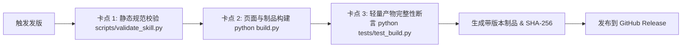

# 发布规范与 Release 指南 (Release Specification & Guide)

本文档定义本项目的**制品打包架构、Agent 技能标准、质量准入门禁、版本命名规范及自动化发版流程**。

---

## 1. 发布制品架构与边界规约

本项目兼具 **Agent 智能体可复用技能** 与 **《冀西南林路行》装帧美学离线数字展品** 双重属性，发布件严格分为两类独立制品及安全校验文件：

### 1.1 制品清单与命名规范

| 制品文件名 | 适用场景 / 目标受众 | 典型大小 | 内容构成 |
| :--- | :--- | :--- | :--- |
| **`omnipotent-youth-society-design.zip`**<br>`omnipotent-youth-society-design-vX.Y.Z.zip` | **Agent 技能分发包**<br>供导入 WorkBuddy 开放平台、Codex CLI、Dify、Coze 等 Agent 宿主环境 | ~1.5 MB | `SKILL.md`、`assets/`（含 `icon.png` 与核心参考图）、`references/`（规范文档）、`templates/`（代码与设计模板）。 |
| **`omnipotent-youth-society-design-kit.zip`**<br>`omnipotent-youth-society-design-kit-vX.Y.Z.zip` | **完整离线设计与研究套件**<br>供设计师、研究者、前端开发者本地离线体验完整画廊与规范 | ~11.6 MB | 编译后的单文件离线页面 `index.html`（内嵌全部压缩图片与书法字体）、完整 `skill/` 目录、`DESIGN.md`、`research/SOURCES.md`、`research/asset-manifest.json`、字体授权。 |
| **`checksums.txt`** | **安全完整性校验** | <1 KB | 所有 ZIP 制品的 SHA-256 哈希值，用于防篡改与完整性校验。 |

### 1.2 打包边界：包含与排除清单

发布制品严禁杂质与冗余，由 CI 流水线基于构建产物纯净打包：

- ✅ **必须打包进 Release**：
  - `skill/` 目录及其下的全部自包含资源（`SKILL.md`, `references/`, `templates/`, `assets/`）。
  - `build.py` 编译生成的单文件离线画廊 `index.html`（已完成资源内嵌与优化）。
  - 设计系统规范 `DESIGN.md` 与学术出处档案 `research/SOURCES.md`。
  - 字体版权许可 `assets/FONT-LICENSE.txt`。
- ❌ **严禁打包进 Release**：
  - **开发模板与源码**：`page.template.html`（未编译的模板源文件对终端用户无意义）。
  - **开发与构建脚本**：`build.py`、`scripts/`（发布制品面向终端使用，非开发环境）。
  - **运行与测试环境依赖**：`requirements.txt`、`requirements-dev.txt`、`tests/`（测试及依赖仅在 CI 阶段执行，终端运行零 Python 依赖）。
  - **未压缩的巨型原始底稿**：`assets/` 中的原始超大扫描原图（单张数兆甚至数十兆，必须只打包经优化压缩后的缩略图及内嵌版）。
  - **版本控制与临时文件**：`.git/`、`.github/`、`preview.tool.html`、`.DS_Store`、`__pycache__/`。

---

## 2. Agent Skill 规范与结构标准

本技能对齐 **WorkBuddy 开放平台技能市场规范** 及通用 Agent Skill 标准：

### 2.1 目录组织结构
```text
omnipotent-youth-society-design/
├── SKILL.md                  # 核心技能入口（含 YAML Frontmatter 元数据）
├── assets/
│   ├── icon.png              # 512×512 技能与项目正方形头像
│   ├── reference-cover.jpg   # 核心设计参考图（自包含）
│   ├── reference-shanghai.jpg
│   ├── reference-taiwan.jpg
│   └── FONT-LICENSE.txt      # 字体许可声明
├── references/               # 补充规约库（由 SKILL.md 通过 @references/ 引用）
│   ├── DESIGN.md             # 构图、色彩、字体、材料设计规约
│   └── SOURCES.md            # 证据层级与原始考据索引
└── templates/                # 生产与代码模板（由 SKILL.md 通过 @templates/ 引用）
    ├── poster-template.svg   # 1px 金石矢量排版与出血折标模板
    ├── web-rubbing-view.html # 纯 CSS 矿物噪点与拓片视口模板
    └── workflow.sh           # 本地流水线与自检脚本
```

### 2.2 解压与平台兼容规范
1. **元数据前置**：`SKILL.md` 顶部必须包含完整的 YAML Frontmatter，且必填字段完整：`name`, `display_name`, `display_name_en`, `icon`, `description`, `description_zh`, `description_en`, `category`, `version`, `author`。
2. **绝对自包含**：所有被引用的资源（`@references/*` 与 `@templates/*`）均必须存在于自身目录内，不得向上层主工程引用 `../`，脱离主仓库独立分发时头像与引用零丢失。

---

## 3. 质量门禁与准入卡点 (Quality Gates)

在任何发布动作生效前，CI 流水线必须依次通过三道严格卡点：



1. **静态元数据与引用校验**：
   ```sh
   python scripts/validate_skill.py
   ```
   检查 Frontmatter 必填字段、图标文件是否存在、`@references/` 和 `@templates/` 引用的文件是否存在。
2. **打包构建完整性**：
   ```sh
   python build.py
   ```
   编译生成单文件 `index.html`，打包生成 `dist/omnipotent-youth-society-design.zip` 与 `dist/omnipotent-youth-society-design-kit.zip`。
3. **产物结构与内容完整性断言**：
   ```sh
   python tests/test_build.py
   ```
   毫秒级断言产物结构、关键 DOM 标记、SVG 模板 XML 合法性、ZIP 内部必选清单以及压缩包大小。
   *(注：如需在本地进行全量浏览器视觉及 E2E 回归测试，可可选安装 `requirements-e2e.txt` 并运行 `python tests/smoke.py`)*。

---

## 4. 发版操作流程 (SOP)

### 方式一：打 Tag 自动发布（推荐标准流程）

1. **更新版本号**：在 [skill/SKILL.md](../skill/SKILL.md) 的 Frontmatter 中更新 `version`（遵循 SemVer 语义化规范，例如 `1.0.1`）。
2. **提交并推送至 main 分支**：
   ```sh
   git commit -am "chore(release): bump version to 1.0.1"
   git push origin main
   ```
3. **打 Tag 并推送到远程**：
   ```sh
   git tag v1.0.1
   git push origin v1.0.1
   ```
4. **CI 自动执行**：GitHub Actions 的 `Release Packages` 工作流将自动触发，通过所有质量卡点后在 GitHub Releases 页面创建新发布，自动挂载带版本号的 ZIP 包、通用 ZIP 包与 `checksums.txt`，并提取 Commit 生成发布日志。

### 方式二：GitHub Actions 页面手动调度发布

如果需要在不立即推送 Tag 的情况下发版（例如发布预发布版本或草稿）：
1. 访问 GitHub 仓库的 **Actions** -> **Release Packages**。
2. 点击 **Run workflow**。
3. 可选参数：
   - **Release tag name**：留空则自动读取 `skill/SKILL.md` 中的版本；亦可手动指定如 `v1.1.0-rc.1`。
   - **Publish as draft**：勾选后仅创建草稿，待人工审查后再公开。
   - **Publish as prerelease**：标记为预发布版本。
